<!-- Customized for mrmshafi. Visual reference and asset attribution: SOURCES.md. -->

<div align="center">

<a href="https://github.com/mrmshafi"></a>


<p>


</p>


<a href="https://github.com/mrmshafi?tab=repositories"></a>


</div>


### 👨‍💻 About Me

I'm **Engr. Mamunur Rashid**. I lead software operations and build production-focused digital products, business systems, websites and automation workflows.

```typescript
const mamun = {
  name: "Engr. Mamunur Rashid",
  github: "mrmshafi",
  focus: ["Healthcare", "Edutech", "ERP", "eCommerce", "Automation"],
  approach: "Design, engineer, deploy, improve."
};
```


<div align="center">

## ⚡ Technology & Tools

<div align="center">


### 「 🎨 Frontend & Interface 」


### 「 ⚙️ Backend & APIs 」


### 「 🗄️ Data & Infrastructure 」


### 「 🚀 DevOps & Delivery 」


### 「 🤖 Product Engineering & Automation 」

    

<sub>Technology areas across my product and engineering work; not a proficiency ranking or a claim that every tool appears in public repositories.</sub>


</div>

## 🚀 Featured Products & Real-World Work

<div align="center">


</div>

<table align="center"><tr>
<td width="50%" valign="top"><div align="center"></div><b>🩺 Telemedicine & Digital Health</b><p>Healthcare application workflows, patient services and digital clinical operations.</p><a href="https://github.com/mrmshafi/telemedicine-app">Public repository (limited published source)</a></td>
<td width="50%" valign="top"><div align="center"></div><b>🎓 Edutech & Smart Campus</b><p>School websites, management platforms, student/staff workflows and connected campus solutions.</p><a href="https://demo.edulogic.online/dashboard">School platform demo</a></td>
</tr><tr>
<td width="50%" valign="top"><div align="center"></div><b>🧩 ERP & Operations Platforms</b><p>Custom management software, operational dashboards, internal processes and integrations.</p><span>Selected private/client projects</span></td>
<td width="50%" valign="top"><div align="center"></div><b>🛒 eCommerce Websites</b><p>Product catalog, commerce workflows, storefront engineering and business integrations.</p><a href="https://brahmaputramart.com/">Brahmaputra Mart</a></td>
</tr><tr>
<td width="50%" valign="top"><div align="center"></div><b>🪪 CardMakerBD</b><p>ID card data collection and mobile photos, institutional profiles, bulk print-ready card generation and fulfillment.</p><a href="https://cardmakerbd.com/">Explore CardMakerBD</a></td>
<td width="50%" valign="top"><div align="center"></div><b>📊 TenderLens</b><p>BOQ review, PWD SoR matching, evidence-based pricing and tender intelligence workflows.</p><span>Product development</span></td>
</tr></table>

<div align="center"><sub>Illustrated project covers are original graphics, not application screenshots. Some professional work is privately hosted or client-owned.</sub></div>

## 🧪 Repositories & Experiments

<details><summary><b>🧰 View public practice and experimental work</b></summary>

| Repository | Public metadata | Link |
| :-- | :-- | :-- |
| test-todo | JavaScript | [Open](https://github.com/mrmshafi/test-todo) |
| gitpractise | HTML | [Open](https://github.com/mrmshafi/gitpractise) |
| test | TypeScript | [Open](https://github.com/mrmshafi/test) |
| telemedicine-app | Repository — source availability may be limited | [Open](https://github.com/mrmshafi/telemedicine-app) |

</details>

<div align="center"><a href="https://github.com/mrmshafi?tab=repositories"></a></div>

## 📊 GitHub Analytics & Contribution Activity

<div align="center">

<!-- Native GitHub contributions are reliable even when external analytics providers are unavailable. -->

<a href="https://github.com/mrmshafi"></a>
<a href="https://github.com/mrmshafi?tab=repositories"></a>


<sub>GitHub's native contribution calendar is available on my profile. External cards may occasionally be unavailable; no misleading static statistics are shown.</sub>

</div>

## 🌍 Animated Contribution Landscape


<div align="center">


<sub>Live widgets are supplied by external services and may display cached data or be temporarily unavailable.</sub>

</div>


## 🐍 Contribution Animation


<div align="center">


</div>


## 🤝 Let’s Connect


<div align="center">

<a href="https://github.com/mrmshafi"></a>

### Build. Experiment. Learn. Improve.


</div>
