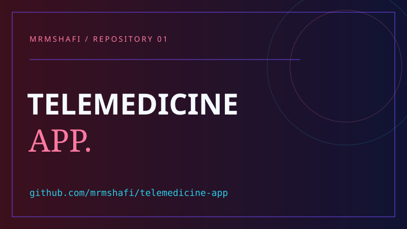
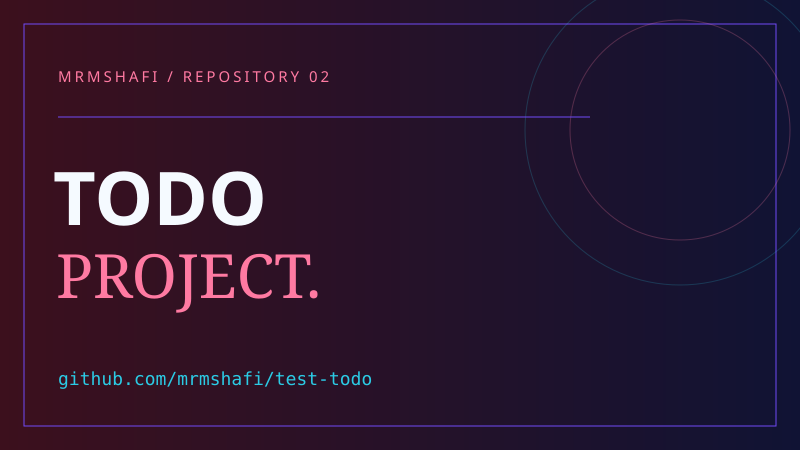
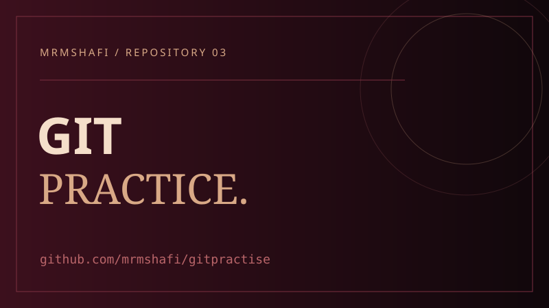
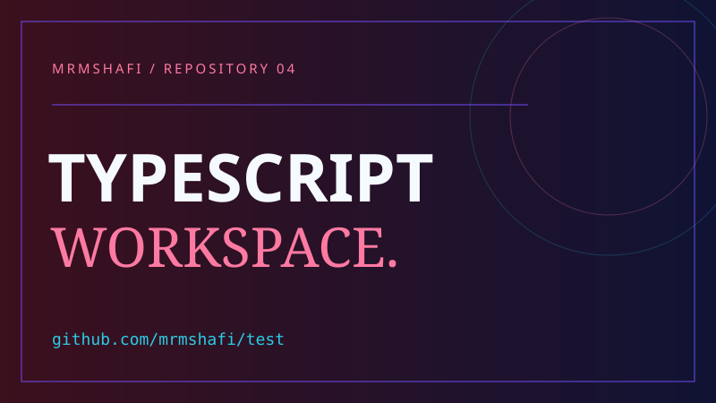

<!-- Customized for mrmshafi. Visual reference and asset attribution: SOURCES.md. -->

<div align="center">

<a href="https://github.com/mrmshafi"></a>


<p>


</p>


<a href="https://github.com/mrmshafi?tab=repositories"></a>


</div>


### 👨‍💻 About Me

I'm **Engr. Mamunur Rashid**. This is my space for sharing projects, experiments, and the things I learn while building.

```typescript
const mamun = {
  name: "Engr. Mamunur Rashid",
  github: "mrmshafi",
  repositories: ["telemedicine-app", "test-todo", "gitpractise", "test"],
  approach: "Build, experiment, learn, improve."
};
```


<div align="center">

## ⚡ Technology & Tools


</div>


<div align="center">

### 「 💻 Repository Languages 」

<br/>


<br/>

</div>


<div align="center">

### 「 🧰 Development & Version Control 」

<br/>


<br/>

</div>


<div align="center">

### 「 🎯 At a Glance 」

<br/>


<br/>

</div>


<div align="center">

<sub>Language badges reflect repository metadata; they are not proficiency scores.</sub>


</div>


## 🚀 Featured Repositories


<div align="center">


</div>


<table align="center"><tr>

<td width="50%" valign="top">
<div align="center">


<br/>

<a href="https://github.com/mrmshafi/telemedicine-app"></a>


</div>

<blockquote><strong>telemedicine-app</strong> — Repository currently contains no published code.</blockquote>

<div align="center">

<a href="https://github.com/mrmshafi/telemedicine-app"></a>

</div>

</td>

<td width="50%" valign="top">
<div align="center">


<br/>

<a href="https://github.com/mrmshafi/test-todo"></a>


</div>

<blockquote><strong>test-todo</strong> — JavaScript repository in my public workspace.</blockquote>

<div align="center">

<a href="https://github.com/mrmshafi/test-todo"></a>

</div>

</td>

</tr><tr>

<td width="50%" valign="top">
<div align="center">


<br/>

<a href="https://github.com/mrmshafi/gitpractise"></a>


</div>

<blockquote><strong>gitpractise</strong> — HTML repository for practice and experimentation.</blockquote>

<div align="center">

<a href="https://github.com/mrmshafi/gitpractise"></a>

</div>

</td>

<td width="50%" valign="top">
<div align="center">


<br/>

<a href="https://github.com/mrmshafi/test"></a>


</div>

<blockquote><strong>test</strong> — TypeScript repository in my public workspace.</blockquote>

<div align="center">

<a href="https://github.com/mrmshafi/test"></a>

</div>

</td>

</tr></table>


<div align="center">

<sub>These are styled repository title covers, not screenshots. Repository status was checked on 2 November 2026.</sub>


</div>


## 🧪 Projects & Experiments

<details>
<summary><strong>🌐 Browse the workspace</strong></summary>

| Repository | Published language | Link |
| :-- | :-- | :-- |
| Telemedicine App | No code published yet | [Open](https://github.com/mrmshafi/telemedicine-app) |
| Todo Project | JavaScript | [Open](https://github.com/mrmshafi/test-todo) |
| Git Practice | HTML | [Open](https://github.com/mrmshafi/gitpractise) |
| Test | TypeScript | [Open](https://github.com/mrmshafi/test) |

</details>


<div align="center">


<a href="https://github.com/mrmshafi?tab=repositories"></a>

</div>


## 📊 GitHub Analytics


<div align="center">


<br/><br/>


<br/><br/>


</div>


<details>
<summary>📈 Alternative Stats Dashboard</summary>

<div align="center">


</div>

</details>


## 🌍 Contribution Landscape


<div align="center">


<sub>Live widgets are supplied by external services and may display cached data or be temporarily unavailable.</sub>

</div>


## 🐍 Contribution Animation


<div align="center">


</div>


## 🤝 Let’s Connect


<div align="center">

<a href="https://github.com/mrmshafi"></a>

### Build. Experiment. Learn. Improve.


</div>
